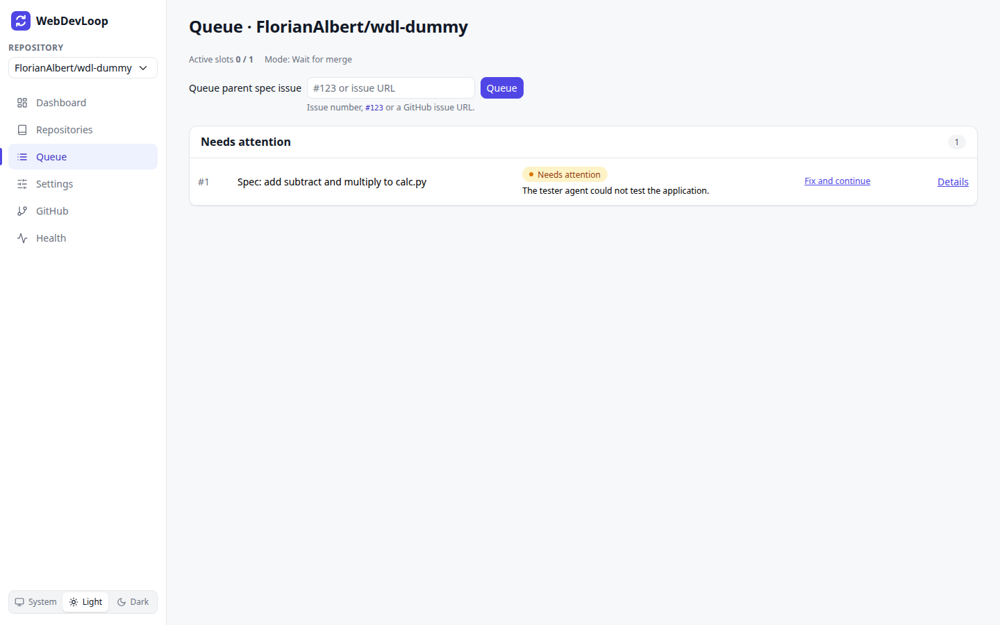

# Queue

The Queue page shows every spec run of the current repository and lets you queue a new spec.

## What you can do here

- Find eligible parent specs, select several, and queue them in your chosen order.
- Queue a known parent spec issue by number or URL as a fallback.
- See how many active slots are used.
- See all spec runs, grouped into lanes.
- Open a run with **Details**, or **Fix and continue** when it needs attention.

## Queue a spec

A spec is a GitHub issue with open sub-issues (the tickets). WebDevLoop does not create the tickets for you.

Before queueing, the parent must be **open** and labeled **`webdevloop`** (WebDevLoop Opt-in), and at least one
sub-issue must independently be **open** and labeled **`webdevloop`**. A parent's label does not opt in its children.
Triage labels such as `ready-for-agent` do not authorize WebDevLoop. Eligible tickets may all be blocked.

### Find and select parent specs

1. Select the connected repository in the sidebar.
2. In **Find parent specs**, search by issue number (with or without `#`) or title, then click **Search**.
3. Optionally select **No open parent blockers**. This checks only the parent's current native blockers, including
   blockers in other repositories. Closed blockers do not exclude a spec; ticket blockers never affect this filter.
4. Use **Load more specs** to see later pages. **Refresh from GitHub** starts again with current GitHub state.
5. Select the specs you want. In **Selected queue order**, use **Move up**, **Move down** and **Remove** to arrange
   the selection. These native buttons work with Tab and Enter/Space as well as a pointer.
6. Click **Queue selected**.

The list excludes pull requests, sub-issues, and specs with unfinished runs. A parent needs at least one independently
opted-in open child to appear. Selections survive search, filtering and refresh, but their eligibility is checked again
when submitted. GitHub state is not continuously monitored. A failed lookup shows access/retry guidance rather than
silently using stale results.

Submission queues each spec in the selected order without reordering runs already in the queue. Every spec gets its
own result, even if an earlier spec fails:

| Result | What to do |
| --- | --- |
| Queued | Open the new run using its link. |
| AlreadyQueued | Open the existing unfinished run using its link; no duplicate is created. |
| Ineligible | Follow the message to reopen or opt in the parent or an open child on GitHub, then retry. |
| GitHubUnavailable | Check GitHub access or retry a temporary failure. |
| RepositoryNotFound | Select a connected repository. |
| ConcurrencyConflict | Refresh the queue and retry. |
| Unavailable | Workflow prerequisites changed during submission. Fix them on [Health](health.md), then retry. |
| Failed | Check the queue before retrying; the message describes an unexpected failure. |

Queued and already-queued specs leave the selection. Failed selections remain for retry or removal. Selection and
queueing controls are disabled while submitting or in diagnostic-only mode. Search and refresh remain available in
diagnostic-only mode, though missing GitHub access may prevent discovery. See [Health](health.md) to restore prerequisites.
On narrow screens the candidate list and selected order stack vertically.

The picker does not create or edit GitHub issues. Change labels, issue state and relationships on GitHub.

### Type an issue number or URL

The **Queue parent spec issue** form remains available when you already know the issue:

1. Select the repository in the sidebar.
2. Enter the issue in **Queue parent spec issue**. You can type `123`, `#123` or the full issue URL.
3. Click **Queue**.

A message tells you what happened:

| Message | Meaning |
| --- | --- |
| Queued #123. | The spec is in the queue. A link opens the run. |
| #123 is already queued. | There already is a run for this issue. A link opens it. |
| The queue changed concurrently. Refresh the queue and retry. | Another change was faster. Refresh the queue, then click **Queue** again. |
| Enter a positive issue number... | The text was not an issue number or URL. |
| Parent spec #123 must be open. | Reopen the parent on GitHub before queueing. |
| Parent spec #123 requires the 'webdevloop' label... | Opt the parent in on GitHub; labeled children cannot authorize the parent. |
| Parent spec #123 needs at least one open sub-issue independently labeled 'webdevloop'. | Add or opt in an open child; the parent's label alone is not enough. |
| Could not verify current GitHub eligibility for #123... | Nothing was queued. Check GitHub access or retry a temporary failure. |
| Could not queue #123: ... | The issue could not be read, for example because it does not exist or the App cannot reach the repository. See [GitHub](github.md). |

The typed form is also disabled while WebDevLoop is in diagnostic-only mode. See [Health](health.md).

The picker, typed form and direct API calls recheck current GitHub state and labels at submission, even if an issue was eligible
when you first saw it. An ineligible spec or failed lookup creates no run. WebDevLoop reads the ticket graph again
when the run starts; this enqueue check does not reserve a snapshot of the tickets.

Scheduling rechecks the same eligibility before starting preparation, including after waiting for parent blockers.
If the parent closes or loses its `webdevloop` label, or every child becomes closed or opts out, the run stays
queued or waiting for dependency with an explanatory note. It holds no active slot and starts no preparation or
agents. Restore the parent's and children's eligibility on GitHub to let normal scheduling retry the same run.
An unavailable eligibility lookup also defers the start and shows access/retry guidance.

## Slots and parent blockers

Above the form you see:

- **Active slots** `0 / 1`: how many specs are being worked on out of the allowed number. The limit is **Max active specs per repository** in [Settings](settings.md#concurrency-review-and-retries). Specs beyond the limit wait in the queue. Specs that await tickets, await merge or need attention do not use a slot.

At each scheduling decision, WebDevLoop re-reads the parent and its current native GitHub blockers.
Every open blocker holds the spec, including issues outside the spec or repository, regardless of opt-in or completed runs.
If the parent or a blocker is unavailable, the decision is deferred with an actionable queue-recovery error and retried
by normal recovery. Independent queued specs can still start. The affected row shows **Blockers unavailable** with
access and refresh guidance; the rest of the queue remains usable. Stale or unknown state never permits a start.

When every blocker is closed or removed, the spec starts from **current trunk**, even if a blocker's pull request is
unmerged. Closing a blocker before merging accepts that its changes may not be on trunk. Queue order cannot bypass
these dependencies. Cross-spec stacking is not supported; ticket pull requests within a spec still form a stack.

### Fully blocked tickets

When every remaining eligible ticket has an open native blocker, WebDevLoop waits for already selected tickets to
finish implementation, review and integration, then parks the spec as **Waiting for tickets**. The note explains why
it is waiting. Its slot is released so independent queued specs can proceed. Partial integration is preserved and
parent review does not start while eligible blocked work remains. Busy agents alone never cause parking.

Normal scheduling and restart recovery fetch current GitHub state, labels and blocker relationships again. Failed
or unavailable lookups defer resumption and show retry guidance, never treating unknown blockers as closed.
Once work is runnable and a slot is free, the same run and integration branch resume in queue order; active specs
are not interrupted. Preparation and integrated tickets are not repeated. You do not need to enqueue a parked spec again.

## Lanes

Runs are grouped into lanes. A lane only shows when it has runs. Within a lane, runs are sorted by queue position.

| Lane | Statuses |
| --- | --- |
| Running | Preparing, Running, Parent reviewing, Testing |
| Awaiting merge | Ready for review, Awaiting merge |
| Needs attention | Needs attention |
| Waiting | Queued, Waiting for dependency, Waiting for tickets |
| Completed | Completed, Aborted |

## Statuses

| Status | What it means |
| --- | --- |
| Queued | Waiting for a free active slot, restored eligibility or a fresh GitHub check. The note explains the current wait. |
| Waiting for dependency | A native parent blocker held this run. Scheduling rechecks blockers and eligibility before starting; the note explains the current wait. |
| Waiting for tickets | Remaining eligible tickets have open native blockers, or resumed work awaits a free slot or a fresh GitHub check. No active slot is held; the note explains the current wait. |
| Preparing | WebDevLoop reads the tickets, creates the integration branch and explores the repository. |
| Running | Tickets are implemented, reviewed and integrated. |
| Parent reviewing | An agent reviews the whole integrated spec. |
| Testing | The tester agent runs the integrated app. |
| Ready for review | The stack of pull requests is ready for you. |
| Awaiting merge | The stack is open and waits for you to merge it. |
| Completed | The stack was merged, or automation finished without further work. The note explains parent opt-out or no eligible work. |
| Needs attention | The run stopped. The row shows the reason and a link such as **Fix and continue**. |
| Aborted | The run was cancelled. |

Every row shows the issue number, the title, the status, a short note and a **Details** link to the [run page](runs.md).

Permission is checked again when selecting tickets and deciding completion. Removing a ticket's `webdevloop`
label prevents new selection but lets selected work finish. If the parent opts out, selected tickets finish
before the run completes without new work or parent review; branches and PRs remain intact.
If no eligible work remains and nothing was integrated, the run completes with a **No eligible work** reason,
without an empty review or PR. Integrated work still proceeds to scoped review; eligible blocked tickets remain
outstanding. Completed runs do not restart when labels change: opt in and queue explicitly again.

The page updates by itself when a run changes.
