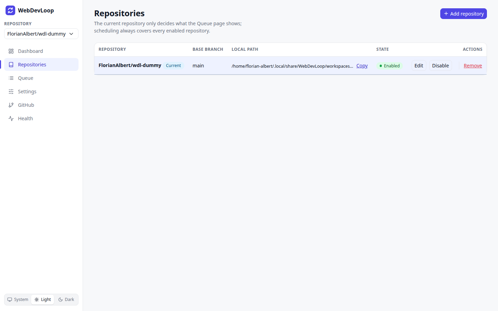
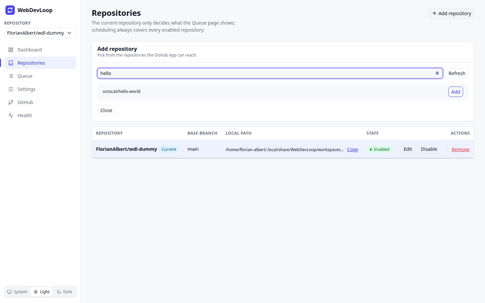
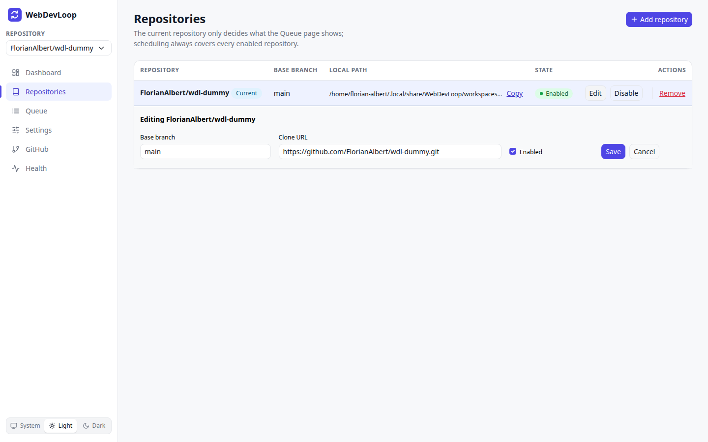

# Repositories

The Repositories page lists the GitHub repositories WebDevLoop works on. You add, edit, disable and remove them here.

## What you can do here

- Add a repository from the ones your GitHub App can reach.
- Change a repository's base branch or clone URL.
- Disable a repository without losing its history.
- Choose the current repository.
- Remove a repository that has no runs.

## The list

| Column | Meaning |
| --- | --- |
| Repository | `owner/name`. The **Current** label marks the repository selected in the sidebar. |
| Base branch | The branch that runs start from and that the stack is merged into. Default `main`. |
| Local path | The local clone WebDevLoop works in, below the workspace root. **Copy** copies the path. |
| State | **Enabled** or **Disabled**, plus the WebDevLoop Opt-in label check and retry/approval controls. |
| Actions | **Use**, **Edit**, **Disable** / **Enable**, **Remove**. |

## Add a repository

1. Click **Add repository**.
2. Wait for the list. It shows the repositories of every GitHub App installation you can access. Use **Filter repositories** to narrow it down. **Refresh** reloads it.
3. Click **Add** next to a repository. WebDevLoop checks for the fixed `webdevloop` label. If it already exists, the repository is added as enabled and shows **Added**.
4. If the label is missing, review the confirmation. **Approve label creation** creates the repository label and completes connection. **Decline** cancels the connection without changing GitHub or adding the repository.
5. Click **Close**.

The list is empty or shows a warning when you are not signed in, or when the App is not installed on the repository. Fix this on the [GitHub](github.md) page.

### WebDevLoop Opt-in label

The fixed `webdevloop` label expresses permission to work on individual issues, independently of triage labels.
Creating the repository label **does not label existing issues** or opt them in.

An already connected repository stays connected if the label is absent or deleted later. Its settings, branches,
pull requests and history stay intact. New specs and tickets pause at the next work decision; already selected
tickets can finish implementation, review and integration. Parent review waits while the label is missing.

Use **Recheck label** in the repository's State column to fetch current GitHub state. If the label is missing,
**Review label creation** opens the same approval dialog. Declining keeps the repository connected but paused.
Approving creates the label; normal scheduling/reconciliation resumes the waiting work without repeating completed
tickets. There is no separate continuous label monitor.

A failed lookup is not treated as a missing label or permission to create one. Lookup and creation errors explain
whether to check GitHub sign-in, repository access or Issues read/write permissions and retry. New work remains
paused for the affected repository while GitHub state is unknown; other repositories continue normally. Normal
recovery retries the check and reports its diagnostics. If creation succeeds but connection subsequently fails, the external label
is preserved; retry the connection after fixing the reported error. Existing repository configuration is never
removed as part of this flow.

## Current repository

The repository box at the top of the sidebar sets the *current repository*. It lists enabled repositories only.

The current repository only decides what the [Queue](queue.md) page shows and which scope the [Settings](settings.md) page opens. It does not change what runs. WebDevLoop schedules work for every enabled repository. WebDevLoop remembers your choice across restarts.

On the Repositories page, click **Use** to make another repository current.

## Edit a repository

Click **Edit** to open the form.

- **Base branch**: the trunk branch of this repository.
- **Clone URL**: where WebDevLoop clones from.
- **Enabled**: untick to stop new work for this repository.

Click **Save**, or **Cancel** to close the form without saving.

## Disable or enable

**Disable** hides the repository from the sidebar and stops WebDevLoop from taking new work from it. Its runs and history stay. Click **Enable** to turn it on again.

## Remove

Click **Remove** and confirm with **Confirm remove**. A repository that already has spec runs cannot be removed. Disable it instead.

## Per-repository settings

Models, limits and prompts can be set for one repository only. See [Settings](settings.md#global-settings-and-repository-overrides).
